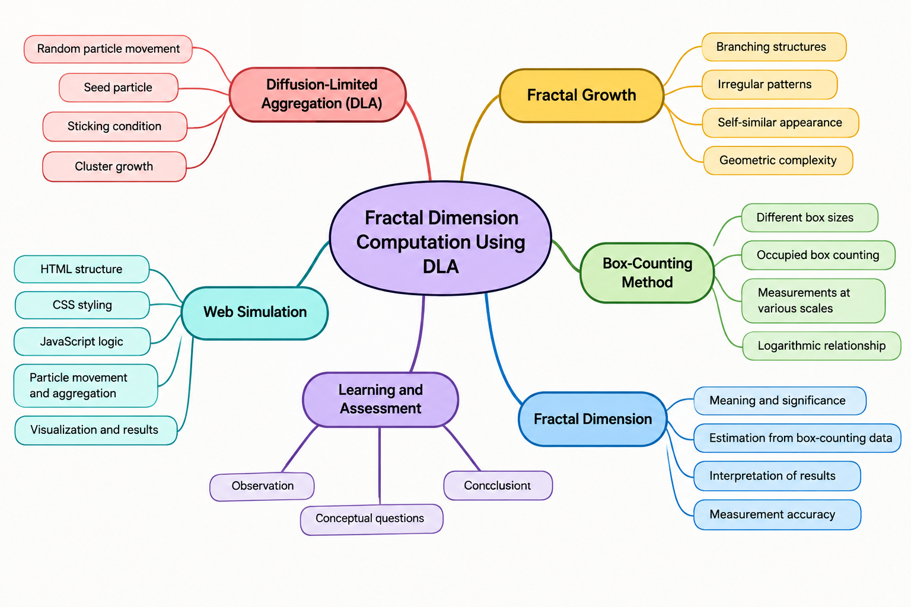

### This directory contains mindmap used in [storyboard document](https://github.com/virtual-labs/ph3-exp-dev-process/blob/main/storyboard/README.org).
## Mindmap

A mind map is a diagram used to visually organize information. A simple mind map represents the main topic at the centre and connects it to related subtopics through branches.

The main objective of a mind map is to visually represent the concepts related to an experiment and show how they are connected.

For this experiment, the central topic is "Fractal Dimension Computation Using Diffusion-Limited Aggregation (DLA)." It is connected to the following subtopics:

### 1. Diffusion-Limited Aggregation (DLA)
- Random particle movement
- Seed particle
- Sticking condition
- Cluster growth

### 2. Fractal Growth
- Branching structures
- Irregular patterns
- Self-similar appearance
- Geometric complexity

### 3. Box-Counting Method
- Different box sizes
- Occupied box counting
- Measurements at different scales
- Logarithmic relationship

### 4. Fractal Dimension
- Meaning and significance
- Estimation from box-counting data
- Interpretation of results
- Measurement accuracy

### 5. Web Simulation
- HTML structure
- CSS styling
- JavaScript logic
- Particle movement and aggregation
- Visualization and results

### 6. Learning and Assessment
- Observation
- Conceptual questions
- Result interpretation
- Conclusion

The mind map helps students understand the relationship between particle aggregation, fractal growth, box-counting analysis, and fractal dimension computation. It also provides developers with a clear overview of the concepts and features required to develop the virtual experiment.

